<div align="center">

<!-- Custom Modern Unix Terminal Header -->
<a href="https://github.com/ndyarrr">
  
</a>

<br/>

<!-- Dynamic Typing Subheading -->
<a href="https://github.com/ndyarrr">
  
</a>

<br/>

<!-- Status Pills -->
<a href="https://github.com/ndyarrr">
  
</a>
<a href="mailto:fandyahmad541@gmail.com">
  
</a>


</div>

<br/>

---

### 💻 `system.profile`

```bash
╭─ fandy@archlinux [zsh] ──────────────────────────╮
│       /\       User   : Fandy Ahmad (ndyarrr)    │
│      /  \      Role   : Fullstack Web Dev        │
│     /\   \     Stack  : React · Laravel · MySQL  │
│    /      \    Kernel : Linux 6.9.0-zen (Arch)   │
│   /   ,,   \   Tools  : VS Code · Zsh · Git      │
│  /   |  |  -\  Locale : Tulungagung, ID          │
│ /_-''    ''-_  Status : Available for hire 🚀    │
╰──────────────────────────────────────────────────╯
```

---

### 🛠️ Stack & Tooling

<div align="center">
  <a href="https://skillicons.dev">
    
  </a>
</div>

<br/>

<details>
  <summary align="center"><b>🐧 Linux Distribution Experience</b></summary>
  <br/>
  <div align="center">
    
    
    
    
    
    
    
  </div>
</details>

<br/>

---

### 📊 GitHub Metrics

<div align="center">
  <a href="https://github.com/ndyarrr">
    
  </a>
  <br/><br/>
  <a href="https://github.com/ndyarrr">
    
  </a>
  <br/><br/>
  <a href="https://github.com/ndyarrr">
    
  </a>
</div>

<br/>

---

### 🤝 Connect & Inquiries

<div align="center">

<a href="mailto:fandyahmad541@gmail.com">
  
</a>
&nbsp;
<a href="https://github.com/ndyarrr">
  
</a>

<br/><br/>


</div>

<br/>

---

### 🐍 Yearly Contribution Timeline

<div align="center">
  <picture>
    <source media="(prefers-color-scheme: dark)" srcset="https://raw.githubusercontent.com/ndyarrr/ndyarrr/output/github-snake-dark.svg">
    <source media="(prefers-color-scheme: light)" srcset="https://raw.githubusercontent.com/ndyarrr/ndyarrr/output/github-snake.svg">
    
  </picture>
</div>

<br/>

<p align="center">
  <sub><code>/* EOF — Designed with Unix minimalism &amp; Catppuccin Mocha */</code></sub>
</p>
